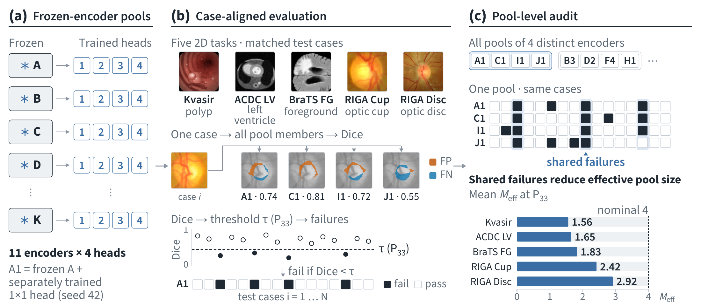
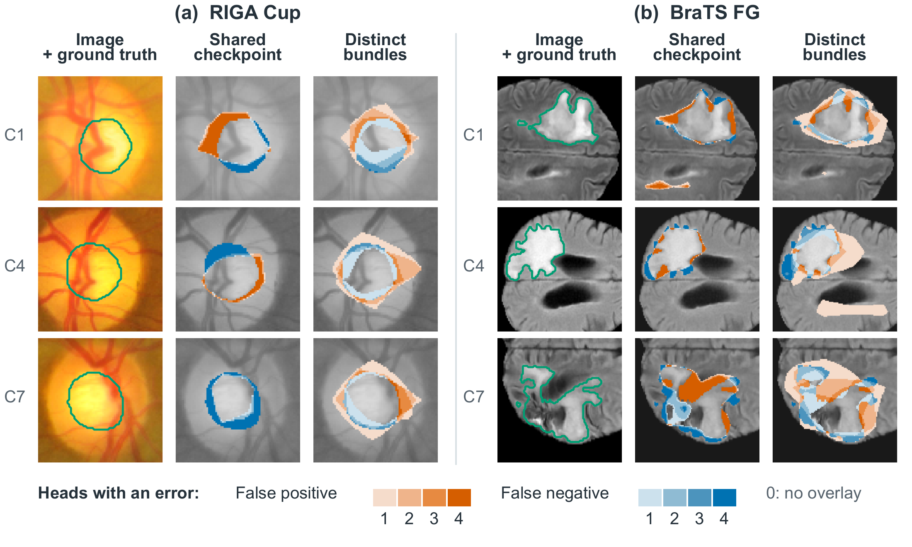
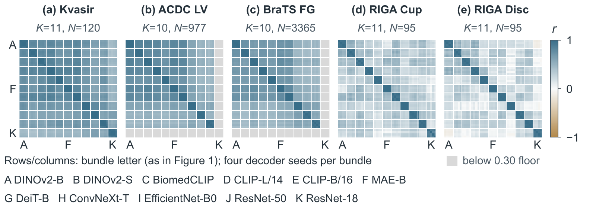

<div align="center">

# CoFailMed

### Different Models, Shared Failures:<br>Auditing Frozen-Encoder Pools for Medical Segmentation

**NeurIPS 2026 · Evaluations and Datasets Track**

Eunseob Choi<sup>1</sup> · Kyeonghun Kim<sup>2</sup> · Hyuk-Jae Lee<sup>3</sup> · Nam-Joon Kim<sup>3,✉</sup>

<sup>1</sup> Gwangju Institute of Science and Technology · <sup>2</sup> OUTTA<br>
<sup>3</sup> Seoul National University · <sup>✉</sup> Corresponding author

[Paper (OpenReview)](https://openreview.net/forum?id=sgt45cOBtI) · [Quick start](#quick-start) · [Reproduce paper results](REPRODUCING.md) · [Data](data/README.md) · [Study code](code/README.md) · [Licence](#licence) · [Citation](#citation)

</div>

**Different models can fail on the same cases.** CoFailMed measures shared failures in medical-segmentation pools using aligned per-case Dice scores. The primary study evaluates **11 pretrained encoders × 4 readout seeds × 5 tasks**, with frozen features and separately trained 1×1 convolutional readouts.

[](assets/overview.pdf)

**Figure 1 — Shared failures reduce effective pool size.** (a) Letters A–K index the 11 frozen encoders and numbers 1–4 their separately trained heads. (b) Every member is evaluated on the same cases, and Dice scores below the threshold become failure events. (c) Dependence is measured in four-member pools drawn from distinct encoders; the bars show mean effective sizes over supported pools at each task's pooled P33 threshold.

Shared checkpoints produce the strongest correlations. Distinct checkpoints within a family remain more correlated than cross-family pairs. At the pooled 33rd-percentile Dice threshold, four-member pools drawn from distinct encoders have mean effective sizes of **1.56–2.92**. Fine-tuning narrows the correlation gap but does not consistently increase effective size at recipe-specific pooled P33 thresholds: **a smaller gap can coexist with greater dependence**.

<details>
<summary>Terms used in this repository</summary>

A *bundle* is one pretrained checkpoint together with its wrapper, input normalisation and feature-extraction path (paper Section 3; checkpoints in Table B.1); the study code calls it `fm`. A *head* is a 1×1 readout trained on a bundle's frozen features with one seed (42–45). *Same/release* pairs are two heads of one bundle, or a DINOv2-B head with a DINOv2-S head; all other pairs form the *cross-bundle* reference. The *gap* Δ is the mean same/release minus the mean cross-bundle per-case Dice correlation. *P33* is the 33rd percentile of all pooled model–case Dice scores after the mean-Dice floor (computed separately for each training recipe), and a *failure* is a Dice score below it. The *effective size* of a four-member pool is 4/(1 + 3ρ̄), where ρ̄ is the mean pairwise correlation of the members' failure indicators.

</details>

## Where errors recur



**Figure 4 — Spatial errors recur across shared-checkpoint heads.** Three RIGA Cup cases (a) and three BraTS FG cases (b) compare four heads sharing DINOv2-B (seeds 42–45) with four distinct encoder bundles (seed 42). The shade gives the number of heads (1–4) that make a false-positive (orange) or false-negative (blue) error at that pixel; green marks the reference boundary in each panel's first column. These examples illustrate spatial recurrence; cohort-level measurements are reported in the paper.

<details>
<summary>Per-case Dice correlation matrices (Figure 2)</summary>



</details>

## Quick start

Seven analysis scripts recompute the paper's statistics from the supplied scores: the central results, the robustness checks and the appendix extensions and diagnostics. They run on CPU with Python 3.10–3.12, NumPy and SciPy; no images or model downloads are needed.

```bash
git clone https://github.com/eunseobchoi/CoFailMed.git
cd CoFailMed
python3 -m venv .venv
source .venv/bin/activate
python3 -m pip install -r requirements.txt

python3 correlation.py --analysis all
python3 effective_size.py
python3 pool_selection.py
```

Each command prints CSV. Add `--output results.csv` to save it.

| Script | Paper results |
|---|---|
| [`correlation.py`](correlation.py) | Table 2 correlation contrasts and hierarchical sensitivity; Table 3 five-ViT comparison; Figure 3(a,b) checkpoint tiers; Figure 5 readout, fine-tuning, random-initialisation and nnU-Net controls |
| [`effective_size.py`](effective_size.py) | Figure 6(a) and Table E.1(b) P33 effective sizes (Table E.1(a): `--analysis fixed`); Table G.4 frozen versus fine-tuned effective sizes and paired changes |
| [`pool_selection.py`](pool_selection.py) | Figure 6(b) and Table I.1(b): 200 calibration/evaluation splits on each of seven tasks, with exact binomial intervals |
| [`sensitivity.py`](sensitivity.py) | Tables D.1 and D.3 point estimates: floor, metric, leave-one-bundle-out, pair-quality adjustment and failure-threshold diagnostics |
| [`control_comparisons.py`](control_comparisons.py) | Table G.3 paired fine-tuning correlation-gap changes; Table G.5 nnU-Net effective sizes |
| [`diagnostics.py`](diagnostics.py) | Appendix diagnostics: Table C.1 bundle quality; Tables D.1(c)–D.5 calibration, failure-event, threshold-crossing and item-difficulty analyses; Tables F.1–F.2 ViT and checkpoint diagnostics; Table G.1 nine-bundle rows; Table G.6; Appendix C.1 |
| [`extensions.py`](extensions.py) | Appendix extensions: Table B.2 mask alignment; Table C.2 per-rater RIGA; Table C.5 and the content-group rows of Tables G.2–G.3; Tables G.7–G.8 AMOS22; Table H.2 medical encoders (Phikon excluded); Tables C.3–C.4 error-mask overlap; Table I.1(a) frozen rows of the primary and held-out tasks, including MSD Spleen and Heart |

Correlation, effective-size, control-comparison and extension commands compute point estimates by default; add `--bootstrap 2000` for the paper's intervals (Table 2's hierarchical and case-bootstrap columns also need `--hierarchical` and `--unit case`), or `--intervals` for `diagnostics.py`. ACDC/BraTS intervals resample patients, Kvasir/RIGA intervals resample images and AMOS22 intervals resample volumes; hierarchical percentiles describe resampling of the observed panel and are separate from these confidence intervals. [Reproducing the paper](REPRODUCING.md) gives the full commands, maps CSV columns to table cells and figure panels, links the [reference outputs](reference_results/) and lists the few values that need masks, predictions or run logs.

Expected primary results:

| Task | Δ (same/release − cross-bundle Dice correlation) | Mean four-member effective size |
|---|---:|---:|
| Kvasir | 0.265 | 1.559 |
| ACDC LV | 0.317 | 1.645 |
| BraTS foreground | 0.340 | 1.828 |
| RIGA Cup | 0.557 | 2.420 |
| RIGA Disc | 0.640 | 2.918 |

Family-selected pools have effective size below two in **910 of 1,400 splits**. The denominator includes **61 unsupported splits**, which are not counted as low effective size. These split frequencies describe the fixed cohorts.

## Files and interpretation

[`scores.py`](scores.py) loads aligned scores, validates model/case identities and applies the bundle-level mean-Dice floor of 0.30. [`data/`](data/README.md) contains three compressed score packs and an error-mask overlap pack (about 12.6 MB in total), split identifiers and metadata; [`MANIFEST.sha256`](MANIFEST.sha256) lists the SHA-256 of these files and the reference outputs, and [`croissant.json`](croissant.json) describes them in Croissant 1.1. The analysis functions can also be imported directly.

The primary contrast groups shared-checkpoint heads and the DINOv2-B/S release pair together. The expanded analysis separates shared checkpoints, distinct checkpoints within a family, and cross-family pairs. Effective size uses **failure correlations**, with failure defined by `Dice < threshold`; it is a threshold-specific variance summary, not a count of independently trained models. Pooled P33 and the calibration-selected threshold are different protocols, documented in [data/README.md](data/README.md).

This repository contains the listed scalar analyses, reference CSV outputs, illustrative paper figures and, in [`code/`](code/README.md), the study implementation used for preprocessing, feature extraction, training, inference and statistics. The top-level analysis routines are extracted from that implementation, and their outputs have been checked against the final paper tables; the [implementation-to-result map](REPRODUCING.md#implementation-provenance) links each routine to its source. Running `code/` requires the upstream datasets and model weights, which are not redistributed. Dataset/model access and experimental details are given in the paper.

## Licence

Project code uses [Apache-2.0](LICENSE). Upstream assets and model-derived data retain their own terms (paper Appendix J, Table J.1). The illustrative figures in [`assets/`](assets/) contain image crops from Kvasir-SEG, ACDC, BraTS 2024 GLI and RIGA+; these crops (cropped, resized and overlaid with error masks) remain under the respective dataset terms listed in [data/README.md](data/README.md#sources-and-terms), for example CC BY-NC-SA 4.0 for ACDC and CC BY-NC for BraTS 2024, and are not covered by the Apache-2.0 grant. The score packs retain applicable attribution and use conditions, documented per panel in [data/README.md](data/README.md#sources-and-terms) together with their intended use. Phikon-derived values are not included because of Owkin's licence; the values that depend on them are listed in [Reproducing the paper](REPRODUCING.md#values-outside-this-release).

## Citation

```bibtex
@inproceedings{choi2026cofailmed,
  title     = {{Different Models, Shared Failures: Auditing Frozen-Encoder Pools for Medical Segmentation}},
  author    = {Choi, Eunseob and Kim, Kyeonghun and Lee, Hyuk-Jae and Kim, Nam-Joon},
  booktitle = {Advances in Neural Information Processing Systems},
  year      = {2026},
  note      = {NeurIPS 2026 Evaluations and Datasets Track},
  url       = {https://openreview.net/forum?id=sgt45cOBtI}
}
```

## Acknowledgements

This work was supported by Artificial intelligence industrial convergence cluster development project funded by the Ministry of Science and ICT(MSIT, Korea)&Gwangju Metropolitan City and the IITP AI Semiconductor Program and the ANCHOR Program, funded by the Korean government and the Seoul Metropolitan Government (IITP-2023-RS-2023-00256081; 2026-ANCHOR-01-110).

The study code builds on [nnU-Net](https://github.com/MIC-DKFZ/nnUNet), [DINOv2](https://github.com/facebookresearch/dinov2), [open_clip](https://github.com/mlfoundations/open_clip), [timm](https://github.com/huggingface/pytorch-image-models), [MONAI](https://github.com/Project-MONAI/MONAI), [MRSegmentator](https://github.com/hhaentze/MRSegmentator) and [TotalSegmentator](https://github.com/wasserth/TotalSegmentator); we thank their authors and maintainers.
